# Tripline App

[Tripline](https://github.com/raychiutw/trip-planner) 旅遊行程規劃的 iOS / Android App。和網站版共用同一個帳號與行程（App 目前以 Email 與密碼登入），在電腦上排好的行程，出門時用手機看。

🌐 **網站版**：[https://trip-planner-dby.pages.dev/](https://trip-planner-dby.pages.dev/)

<table>
  <tr>
    <td align="center">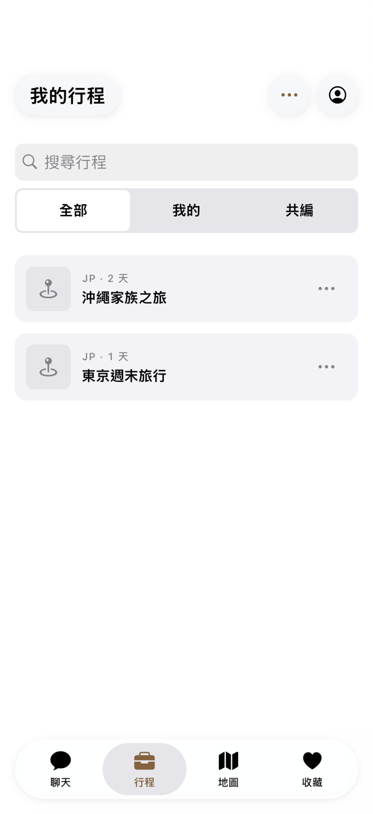 我的行程</td>
    <td align="center">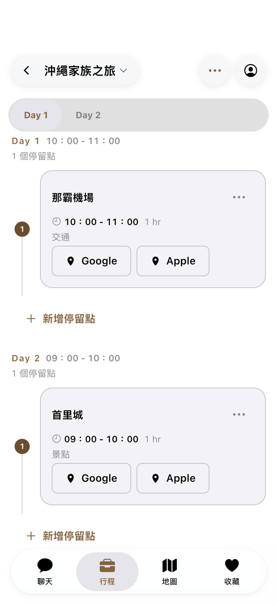 每日時間軸</td>
    <td align="center">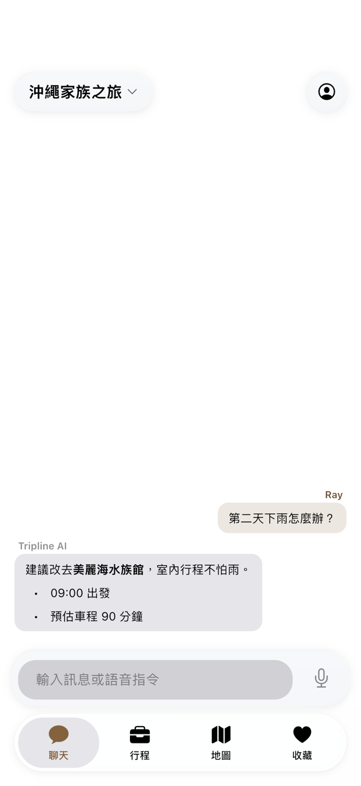 問 AI 改行程</td>
    <td align="center">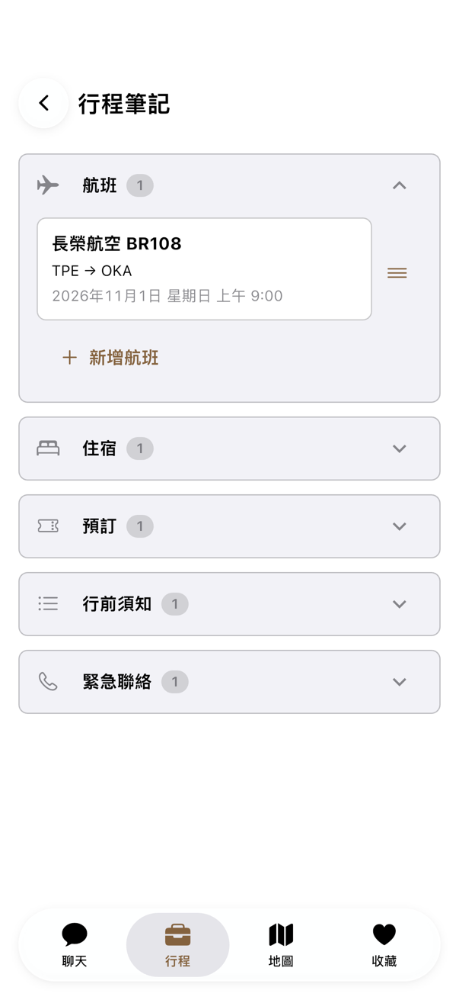 行程筆記</td>
  </tr>
</table>

## 功能特色

### 💬 用說的就能改行程

在聊天分頁輸入或用語音說「第二天下雨怎麼辦？」，AI 會依照你的行程給建議，也能直接幫你調整停留點。

### 🗓️ 每天去哪裡一目了然

- **每日時間軸**：每個停留點的時間、停留多久與類型排得清清楚楚，一鍵在 Google 地圖查看地點（iPhone 也能用 Apple 地圖開啟）
- **每日路線地圖**：原生地圖上標出每天的停留點與路線，地圖和下方的停留點卡片同步捲動
- **隨手調整**：新增、編輯、刪除停留點；點「調整順序」後拖曳就能改變先後

### 🧳 出發前準備好

- **行程筆記**：航班、住宿、預訂、行前須知與緊急聯絡分成五類，可以新增、編輯與排序
- **探索與收藏**：搜尋景點與餐廳，先收藏起來，之後再加進行程
- **建立行程**：選目的地與日期，就能開始安排

<table>
  <tr>
    <td align="center">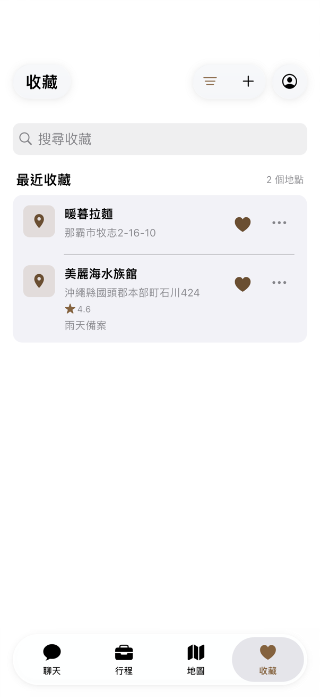 收藏</td>
    <td align="center">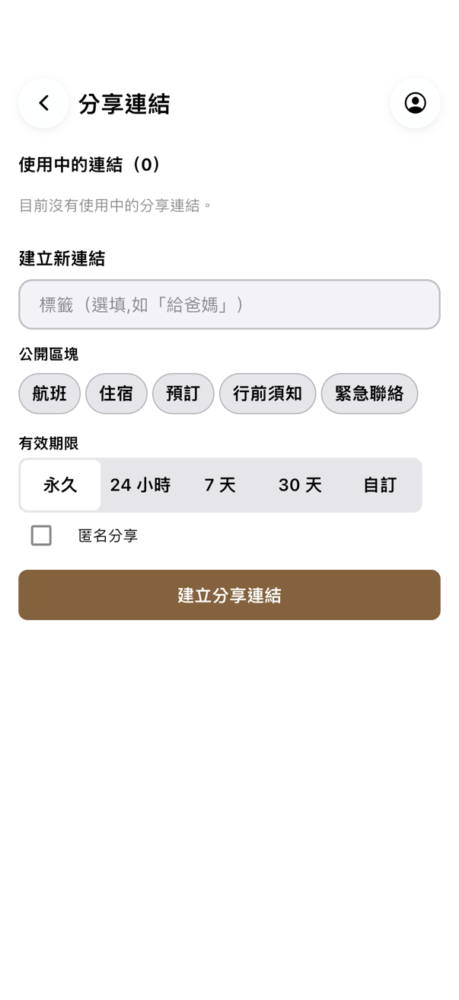 建立分享連結</td>
    <td align="center">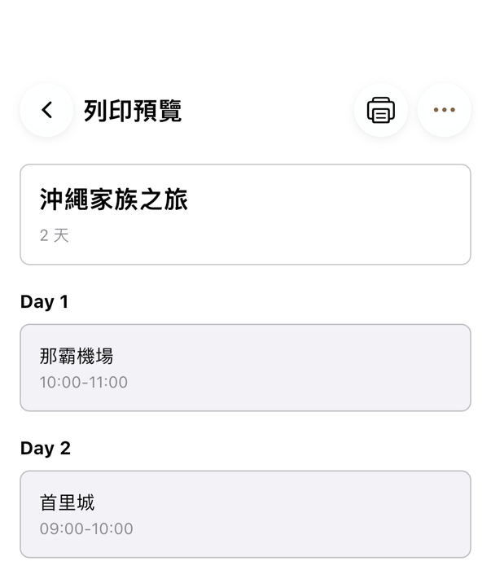 列印預覽</td>
  </tr>
</table>

### 👫 和旅伴一起

- **共同編輯**：邀請旅伴加入同一份行程
- **分享連結**：產生唯讀連結，可設定有效期限、要公開哪些筆記，也能匿名分享；旅伴用瀏覽器開啟就能看，不用登入
- **列印與匯入**：整份行程輸出成列印文件或 PDF，也能匯入從 Tripline 匯出的行程檔

### 📶 沒有網路也能用

看過的行程會存在手機裡，在國外沒有網路時照樣能看。離線時新增或修改停留點，以及新增、修改、刪除行程筆記，都會先保留，連上網路後自動同步；刪除停留點、調整順序等其他操作需要連上網路。

### 🌙 舒服好讀

- **深色模式**：跟隨系統、淺色或深色
- **大字級與高對比**：支援系統的文字大小設定；iPhone 另支援「增加對比」
- **iOS 風格的介面**：iPhone 與 Android 都使用 Liquid Glass 風格的導覽列與 iOS 的操作習慣

<table>
  <tr>
    <td align="center">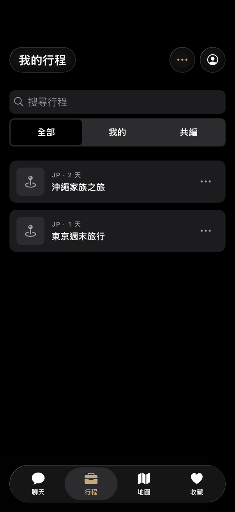</td>
    <td align="center">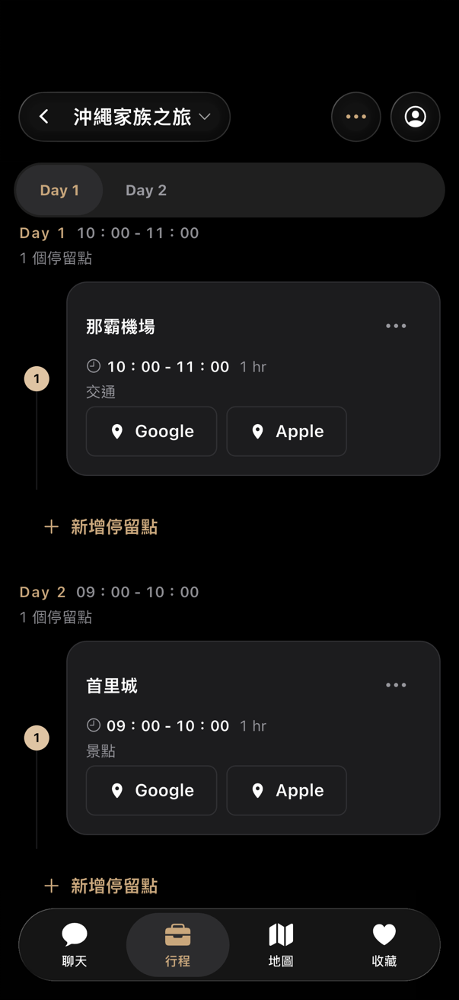</td>
    <td align="center">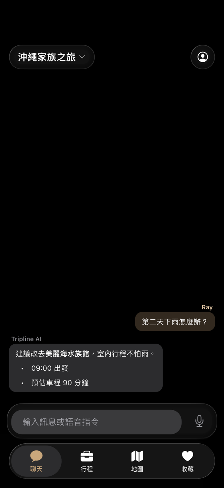</td>
    <td align="center">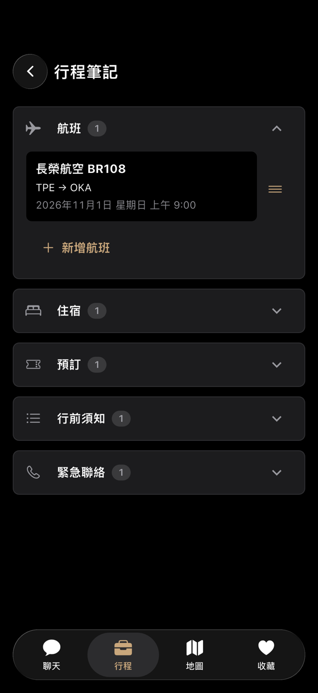</td>
  </tr>
</table>

### 🔒 帳號與隱私

- 查看登入過的裝置，可以登出單一裝置
- 隨時可以在 App 內永久刪除帳號

> 截圖使用範例資料。

